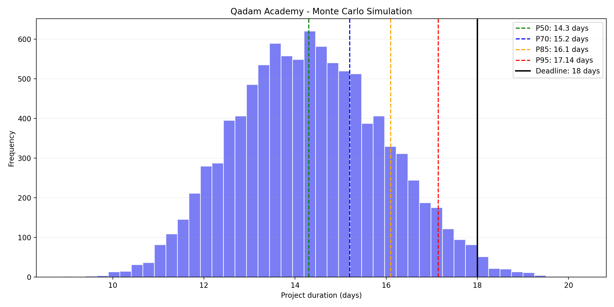

# Qadam Academy — Monte Carlo симуляциясы

Күні: 27.11.2026

## 1. Мақсаты

Жобаның қалған жұмыстарын аяқтау мерзімін
ықтималдық әдісімен бағалау.

## 2. Бастапқы параметрлер

- Симуляциялар саны: 10000.
- Бағдарламалау тілі: Python 3.9.6.
- Үлестірім: үшбұрышты үлестірім.
- Random seed: 42.
- Басталу күні: 27.11.2026.
- Аяқталу мерзімі: 15.12.2026.
- Қолжетімді уақыт: 18 күн.

## 3. Үш нүктелік бағалау

| Жұмыс | Оптимистік | Ықтимал | Пессимистік |
|---|---:|---:|---:|
| Жобаны басқару құжаттары | 1 | 2 | 4 |
| Қалған зертханалық жұмыстар | 3 | 5 | 9 |
| Құжаттарды сәйкестендіру | 1 | 2 | 3 |
| Қорытынды тестілеу | 1 | 2 | 4 |
| Қорытынды презентация | 1 | 2 | 3 |

Өлшем бірлігі: күн.

## 4. Симуляция нәтижелері

| Перцентиль | Ұзақтығы | Аяқталу күні |
|---|---:|---|
| P50 | 14,30 күн | 12.12.2026 |
| P70 | 15,20 күн | 13.12.2026 |
| P85 | 16,10 күн | 14.12.2026 |
| P95 | 17,14 күн | 15.12.2026 |

Жобаны белгіленген мерзімде аяқтаудың
модельдік ықтималдығы: 98,73%.

## 5. График

## 6. Басқарушылық шешім

Жоспарлау үшін P85 көрсеткіші таңдалды.

Мақсатты аяқталу күні: 14.12.2026.
Соңғы мерзім: 15.12.2026.
Күнтізбелік резерв: 1 күн.

Жаңа функцияларды қосу кезінде симуляцияны
қайта жүргізу қажет.

## 7. Шектеулер

Жұмыс ұзақтығы сараптамалық бағалау арқылы
анықталды.

Тапсырмалар тәуелсіз және тізбекті түрде
модельденді.

Нақты еңбек өнімділігі өлшенбеген.
Жаңа Premium функциялары есепке алынбаған.
98,73% — модельдік нәтиже, нақты кепілдік емес.

## 8. Артефактілер

- planning/monte_carlo.py
- planning/monte_carlo_results.json
- planning/plot_monte_carlo.py
- planning/monte_carlo.png
